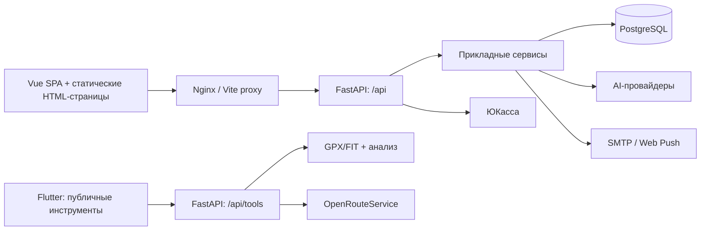
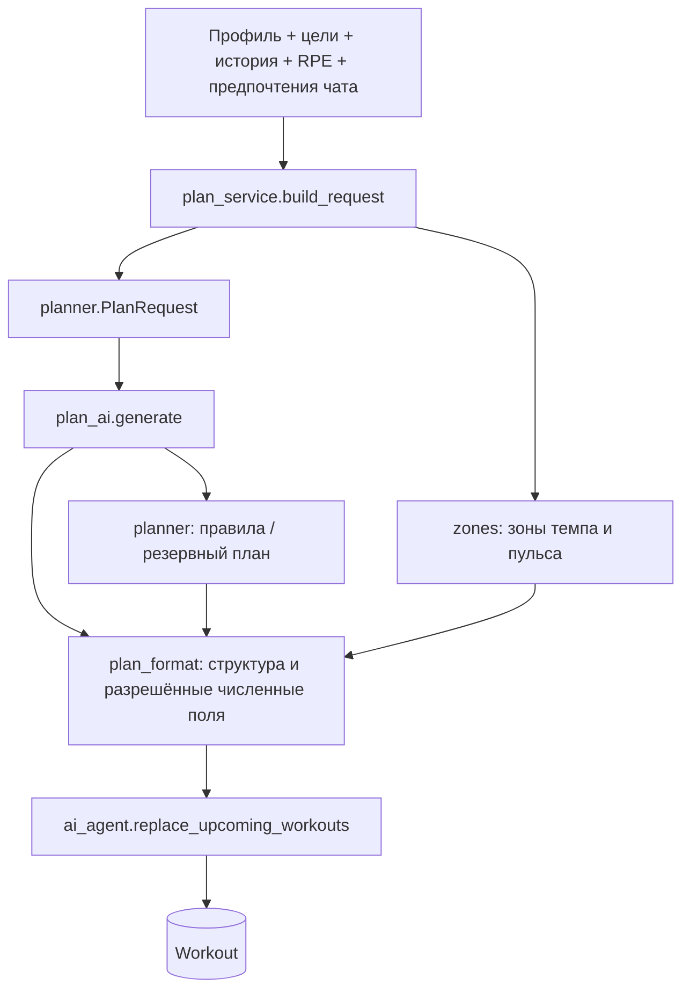

# Карта проекта AIRunningCoach

Обновление 2026-11-16: чат всех пользователей использует агентный путь в
`backend/app/services/coach_agent.py`, без флагов включения и списков аккаунтов.
Инструменты читают данные и готовят проверенное
предложение Пн–Вс; сохранение — через существующий endpoint подтверждения,
с проверкой актуальности и без перезаписи прошедших/выполненных дат.
Квоты правок, ограничения и деплой: `COACH_AGENT_ROLLOUT.md`.
Описания прежнего пути чата ниже сохранены как исторический контекст. Агентные
предложения используют `plan_draft.agent_version=1`, отдельной миграции нет.

Недельный ограничитель: `planner.week_cap_km` отдельно от `week_target_km`.
При ≥3 завершённых наблюдаемых неделях он равен
`max(15, 1.25 × median(последние 6 недель), 1.20 × последняя неделя)`.
`history_stats(..., timezone_name)` возвращает `completed_weeks`,
`plan_service.build_request` переносит их в `PlanRequest.completed_week_km`.
Агент, промпт обычного генератора и `enforce_envelope` используют общий расчёт.
При нехватке истории — `max(15, 1.20 × объём профиля)`, без профиля — 15 км.
Потолок не является назначением нагрузки; полный протокол после болезни
не реализован. Подробности — в `COACH_AGENT_ROLLOUT.md`.

Проверено по исходникам 2026-11-02. Это краткая рабочая память для следующих задач: сначала найти нужный контур здесь, затем перечитать соответствующий код. Карта описывает содержимое рабочей папки, включая пока не отслеживаемые Git каталоги; наличие кода не означает его подключение или развёртывание.

## Общая схема

Это монорепозиторий с одним основным API. Отдельных сервисов очередей и Redis в Compose нет; фоновые задачи исполняются внутри backend. Бизнес-логика распределена между роутерами и сервисами, отдельного repository-слоя нет.

## Каталоги и точки входа

| Путь | Назначение / что читать первым |
| --- | --- |
| `backend/app/main.py` | FastAPI, подключение роутеров, SQLAdmin, CORS, lifespan планировщика, резервная раздача SPA |
| `backend/app/routers/` | HTTP-контракты, проверки доступа, часть бизнес-операций и транзакций |
| `backend/app/services/` | AI, планы, зоны, импорт, анализ, достижения, письма и уведомления |
| `backend/app/models.py` | Все SQLAlchemy-модели и связи данных |
| `backend/app/schemas.py` | Pydantic-схемы запросов и ответов |
| `backend/app/core/config.py` | Настройки окружения; значения секретов в карту не включать |
| `backend/app/database.py`, `dependencies.py`, `auth.py` | Engine/сессии БД, текущий пользователь/администратор, JWT и пароли |
| `backend/alembic/` | Источник изменений схемы БД |
| `backend/tests/`, `backend/scripts/` | Тесты; отдельные скрипты диагностики, seed и backfill |
| `frontend-v2/src/main.ts` | Vue + Pinia + i18n + router, UTM, регистрация service worker |
| `frontend-v2/src/router/index.ts` | Маршруты и guards авторизации, администратора, онбординга |
| `frontend-v2/src/pages/`, `components/` | Страницы и компоненты приложения |
| `frontend-v2/src/stores/` | Pinia: auth, activities, training, goals, chat, insights, achievements, support |
| `frontend-v2/src/api/{client,index,types}.ts` | HTTP-транспорт, методы доменов, TypeScript-контракты |
| `frontend-v2/public/` | Самостоятельные HTML: landing, blog, tools, en, privacy, terms; также SW и статические ресурсы |
| `frontend-v2-dist/` | Результат сборки, редактировать исходники в `frontend-v2/` |
| `mobile/lib/main.dart` | Текущая точка входа Flutter: `ToolsHomeScreen` |
| `route-generator/`, `gpx-analyzer/` | Отдельные HTML-прототипы; рабочие веб-инструменты находятся также в `frontend-v2/public/tools/` |
| `design-source/` | Исходные графические материалы (сейчас лист бейджей) |
| `nginx/`, `docker-compose*.yml`, `.github/workflows/deploy.yml` | Проксирование, локальный запуск, сборка и деплой |
| `.agents/` | Локальные заметки по маркетингу и patch notes; не код приложения |

Дополнительный контекст: `README.md` — запуск, `PLAN_GENERATION_ROADMAP.md` — планы развития, `LOCAL_PLAN_CHECK.md` — проверка планов, `CODE_REVIEW_CHECKLIST.md` — чеклист. Описание поведения сверять с кодом: часть комментариев и документации отстаёт.

## Вертикальные связи: экран → состояние → API → логика

Все API-префиксы в таблице включают `/api`, добавляемый в `main.py`.

| Функция | Vue: страницы / компоненты / store | Backend |
| --- | --- | --- |
| Вход и профиль | `LandingPage`, `auth/AuthPage`, `auth/AuthCard`, `AuthCallbackPage`, `OnboardingPage`, `ProfileModal` → `auth` → `authApi` | `/auth` → `routers/auth.py`, `auth.py`, `dependencies.py`; email, ALTCHA, Google OAuth |
| Дашборд | `DashboardPage`, `WeeklyVolumeChart`, `WorkoutMeta` → activities/goals/training/insights | `/activities/stats`, `/training/workouts`, `/goals`, `/ai-insights/dashboard` |
| Пробежки | `ActivitiesPage` → `ActivityList` → `ActivityCard` / `ActivityModal` / `ActivityDetail` → `activities` | `/activities` → парсеры GPX/FIT, safe_fetch, workout_verification, achievements, plan_service, ai_agent |
| Детальный разбор | `ActivityAnalysisPage` → `TrackChart`, Leaflet, `utils/activityNarrative.ts`; прямой `activitiesApi.detail` | `/activities/{id}/detail` → сохранённые track_points, splits, laps, analysis |
| План | `TrainingPage`, `WorkoutMeta` → `WorkoutSegments`, `PlanDataModal`; store `training` | `/training` → ai_agent, plan_service, plan_ai, planner, plan_format, zones, workout_verification |
| Цели | `GoalsPage` → `GoalList` → `GoalCard` / `GoalModal` → `goals` | `/goals` → `Goal`; цели читаются генератором плана и AI-контекстом |
| Тренер | `CoachPage`, `ChatPlanProposal`, также компонент `ChatBox` → `chat` | `/chat` → ai_agent, chat_prefs, rate_limit; сообщения и черновики в `ChatMessage` |
| AI-инсайты | store `insights`, компоненты/страницы дашборда и тренера | `/ai-insights/dashboard` → ai_agent + insights_cache |
| Достижения | `AchievementsPage`, store `achievements` (счётчик) → `achievementsApi` | `/achievements` → PersonalRecord/UserAchievement, running_standards, achievement_defs |
| Подписка | `SubscriptionPage`, `PaymentSuccessPage`, `RateLimitBadge`, `TrialExpiredBanner` | `/payments` → ЮКасса, Payment и premium-поля User; лимиты в rate_limit |
| Поддержка | `SupportPage`, `SupportTicketPage`, `AdminToolsPage`, store `support` (счётчики) | `/support/tickets`, `/admin/support` → services/support.py → SupportTicket/SupportMessage |
| Админ-аналитика | `AdminAnalyticsPage`, `admin/BarChart` → `adminAnalyticsApi` | `/admin/analytics` → users, activities, messages, usage, payments |
| Push | `ProfileModal` → `usePush` → `pushApi`; `public/sw.js` | `/push` → PushSubscription, push_notifications |
| Публичные инструменты | Статические HTML в `public/tools/` и Flutter-экраны | `/tools/analyze` → GPX/FIT; `/tools/route` → OpenRouteService; без авторизации |

Страницы могут обращаться прямо к `api/index.ts`, минуя store. `AppLayout.vue` — общая оболочка: навигация, тема/язык, профиль, счётчики чата/поддержки/достижений, диалоги и баннер триала. Не все файлы компонентов обязательно используются текущими страницами — проверять импорты.

## Ключевые потоки и побочные эффекты

### Добавление и импорт пробежки

1. Ручная запись: `POST /activities`. Файл: `POST /activities/import`. Ссылка: `POST /activities/import-url` через `safe_fetch.py`.
2. `gpx_parser.py` / `fit_parser.py` нормализуют данные и вызывают `activity_analysis.compute_analysis`. Это вычислительный разбор трека, отдельный от AI-комментария.
3. Роутер сохраняет `Activity`, ищет тренировку плана через `workout_verification` и обновляет её статус выполнения.
4. Сбрасывает серверный кеш инсайтов, пересчитывает достижения и обновляет численные параметры будущих тренировок по новым зонам.
5. Для свежих активностей ставит `analyze_new_activity` в `BackgroundTasks`: AI-комментарий попадает в чат. Клиент получает `ai_analysis_pending`.

При изменении/удалении активности отдельно проверять соответствующие handlers: набор побочных эффектов может отличаться. Большие `Activity.track_points` и `Activity.analysis` объявлены deferred: списковые запросы не должны загружать их целиком.

### Генерация и обновление плана

- `plan_service.py` связывает БД с расчётным ядром; `planner.py` — правила построения, `zones.py` — оценка зон, `plan_ai.py` — AI-генерация/обработка ответа и fallback, `plan_format.py` — формат структуры и пересчёт чисел.
- `ai_agent.py` координирует AI-контекст, провайдеров, генерацию, запись тренировок, черновики и фоновые jobs. Это центральный модуль с широким влиянием.
- Фактически разрешены **1 и 4 недели** (`WEEKS_ALLOWED` в `routers/training.py`). Упоминания 12 недель в клиентских комментариях устарели.
- Неделя генерируется в запросе; месяц требует Premium и собирается в фоне. Состояние хранится в `PlanJob`, frontend опрашивает `/training/plans/status` каждые 5 секунд.
- Профиль/активности могут вызвать `refresh_after_change`: пересчитываются параметры будущих невыполненных тренировок v2 по текущим зонам. Это не полная AI-перегенерация плана.
- `Workout.planned_date` — дата тренировки; `day_of_week` должен ей соответствовать. `plan_structure` поддерживает новые и старые представления; отображение проверять также в `utils/plan.ts`, `WorkoutMeta` и `WorkoutSegments`.

### Изменение плана через чат

`POST /chat/message` → `coach_agent.respond` → чтение сводки/календаря инструментами → `preview_calendar_change` → проверка всей недели → публикация `plan_draft` → `ChatPlanProposal` → явное подтверждение через `POST /chat/plans/confirm` → `coach_agent.confirm` → запись редактируемых дат. Старые предложения без `agent_version` подтверждаются через `confirm_plan_draft`.

Разговор с тренером и применение черновика — отдельные действия. Новые договорённости сохраняются в предложении недели. `chat_prefs.py` хранит прежние предпочтения: число дней, день длинной и заметку со сроком; они продолжают читаться агентом и обычной генерацией, а редактирование профиля сохраняет прежние правила сброса.

### AI, кеши и фоновые операции

- Порядок настроенных провайдеров в `_providers()`: custom → Groq → DeepSeek → Gemini. Используется OpenAI-совместимый SDK; наличие SDK не означает, что запросы идут в OpenAI. Есть переключение провайдеров, cooldown и режим без настроенных провайдеров.
- `rate_limit.py` + `ApiUsage` ограничивают AI-операции с учётом доступа/подписки.
- `insights_cache.py` хранит кеш в БД с TTL 2 часа. Сброс вызывается из отдельных mutation-handlers, автоматической общей инвалидации ORM нет.
- `utils/cache.ts` хранит данные части Pinia stores в localStorage: сначала показ кеша, затем обновление; версия `__BUILD_ID__` меняется при сборке. Logout очищает этот кеш. Это отдельный слой от кеша инсайтов в БД.
- `trial_emails.py` запускает APScheduler из lifespan: письма триала, недельная статистика, истечение Premium, сверка платежей. PostgreSQL advisory lock выбирает один процесс планировщика среди workers.
- `BackgroundTasks` и PlanJob не являются внешней надёжной очередью. При изменениях долгих операций учитывать перезапуск процесса и обработку незавершённого состояния.

## Данные и связи

Все модели находятся в `backend/app/models.py`.

| Сущность | Связи / смысл |
| --- | --- |
| User | Профиль, часовой пояс, онбординг, верификация, premium и маркетинговые атрибуты |
| Activity | `user_id → User`; фактическая тренировка, источник, метрики и JSON-детализация |
| Goal | `user_id → User`; могут существовать несколько целей, состояния achieved/abandoned/active |
| Workout | `user_id → User`, `activity_id → Activity` (необязательно); план, структура, RPE и статус подтверждения |
| ChatMessage | `user_id → User`; история, AI-комментарии, состояние/данные предложения плана |
| PlanPreference | Один набор предпочтений на пользователя |
| PlanJob | Задания генерации для пользователя и их состояние |
| PersonalRecord / UserAchievement | Пользователь + связанная активность; рекорды и бейджи |
| Payment / ApiUsage | Платежи и журнал расхода AI по пользователю |
| InsightsCache / PushSubscription | Кеш инсайтов и подписки браузеров по пользователю |
| SupportTicket / SupportMessage | Автор тикета; сообщения связаны с тикетом и отправителем |

`Activity` — выполненный факт, `Workout` — запланированное занятие; их нельзя подменять друг другом. Подтверждение выполнения — `workout_verification.py`, статусы `none / completed / approximate / unconfirmed`. Время и дни недели проверять с учётом `User.timezone`: в коде встречаются также серверные даты.

## Flutter и прототипы

- Текущий запуск: `mobile/lib/main.dart` → `ToolsHomeScreen` → экраны калькулятора темпа, зон пульса, прогноза, нормативов, анализа файла и генератора маршрута.
- Анализатор и генератор Flutter обращаются напрямую к `https://airunningcoach.pro/api/tools/...`; изменение общего `ApiClient` не переключит эти адреса.
- `AuthState`, `api/auth_api.dart`, `activities_api.dart`, `chat_api.dart`, `HomeShell`, экраны входа/регистрации/активностей/чата сохранены, но не подключены к текущему запуску. В этом контуре используются Provider/ChangeNotifier, shared_preferences для JWT и `ApiClient` с адресом по умолчанию `http://10.0.2.2/api`.
- `route-generator/index.html` — standalone с прямым обращением к ORS; веб-версия в `public/tools/generator-marshrutov/` уже использует backend-прокси `/api/tools/route`. README прототипа не описывает интегрированную версию.
- `gpx-analyzer/index.html` — отдельный прототип; интегрированная точка входа веба — `public/tools/analiz-gpx-fit/index.html`.
- Изменение standalone HTML не обновляет автоматически публичную или мобильную версию.

## Запуск, сборка и маршрутизация

- Backend: из `backend/` установить `requirements.txt`, применить `alembic upgrade head`, запустить `uvicorn app.main:app --reload --port 8000`. Настройки читаются через `core/config.py`; БД по окружению, поддерживается SQLite для локальных сценариев.
- Веб: из `frontend-v2/` выполнить `npm ci`, `npm run dev` (5173). Vite проксирует API на `VITE_API_TARGET` либо `http://localhost:8000`.
- Сборка: `npm run build` = `vue-tsc -b` → Vite → `scripts/inject-sw-version.mjs`; результат в `frontend-v2-dist/`, включая файлы `public/`.
- `public/sw.js`, `__BUILD_ID__` и инъекция версии SW участвуют в обновлении клиентского кеша после деплоя.
- Основные Compose-сервисы: PostgreSQL 16, backend и Nginx. `backend/entrypoint.sh` применяет миграции и запускает 2 workers.
- `docker-compose.override.yml` автоматически влияет на обычный локальный Compose-запуск: исходники backend, reload и порт 8000; Nginx использует `nginx/nginx-local.conf`. Оба локальных файла существуют, но исключены через `.gitignore`, поэтому обычный `rg --files` их не показывает. `docker-compose.dev.yml` также ссылается на локальный конфиг. Фактический запуск этих конфигураций не проверялся.
- Текущий workflow деплоя запускает **postgres + backend**, собирает/загружает веб и обновляет **системный Nginx** по `nginx/nginx-native.conf`. Контейнерный Nginx сохранён в основном Compose как альтернативный вариант; не приравнивать его к текущему сценарию workflow.
- Nginx отдаёт статические страницы и SPA; `/api/`, `/sqladmin`, health/docs проксируются в backend. Старый URL `/auth/google/callback` переписывается в API callback.
- `/admin` — Vue-инструменты; `/sqladmin` — отдельная серверная админка из `backend/app/admin.py`.
- `main.py` умеет резервно отдавать SPA при наличии каталога сборки. Старый `frontend/` упоминается как fallback, но в текущей корневой папке отсутствует.
- `routers/strava_webhook.py` и `services/strava.py` существуют, однако Strava-роутер не подключён в `main.py`. Наличие этих файлов не означает доступность webhook в текущем API.

## Что проверять вместе при изменениях

| Изменение | Связанные места |
| --- | --- |
| Поле запроса/ответа | models + schemas + router + `src/api/types.ts` + `src/api/index.ts`; для мобильного контура ещё Dart-модели/API |
| Схема БД | models + новая Alembic-миграция; запуск не опирается на `create_all` |
| Расчёт плана/зон | zones + planner + plan_service + plan_ai + plan_format + ai_agent + отображение сегментов |
| Импорт/правка активности | Парсеры + analysis + matching workout + достижения + кеш инсайтов + обновление плана |
| Пожелания и предложения в чате | chat router + ai_agent + chat_prefs + ChatMessage/PlanPreference + ChatPlanProposal/store |
| Подписка и лимиты | payments + rate_limit + trial_emails + User/Payment/ApiUsage + интерфейс подписки |
| Общий дизайн/локализация | `style.css`, `i18n/ru.ts`, `i18n/en.ts`; статические HTML и Flutter имеют отдельные стили/тексты |
| Маршрут или публичная страница | Vue router либо `public/` + Vite publicDirIndex + Nginx + SW |

## Проверки для будущих задач

- Backend: из `backend/` — `python -m pytest` после установки `requirements-dev.txt`. Есть тесты planner, zones, plan_format, plan_ai, providers, plan jobs/API, chat preferences и verification.
- `backend/tests/conftest.py` задаёт тестовое окружение и in-memory SQLite; PostgreSQL-specific locks этими тестами не подтверждаются.
- Frontend: `npm run build` проверяет TypeScript и сборку; отдельного test-script в package.json нет.
- CI в `deploy.yml`: сборка frontend, компиляция Python и пробный импорт FastAPI; pytest там сейчас не запускается.
- Диагностические скрипты `ai_plan_check.py` и `check_groq_proxy.py` рассматривать отдельно от unit-тестов: перед запуском читать код, поскольку они могут обращаться к внешним сервисам.

При составлении этой карты приложение, БД, внешние API и тесты не запускались. Это статический анализ связей, а не подтверждение работоспособности окружения. Обновлять карту при смене точек входа, контрактов, подключения модулей или сценария деплоя.
